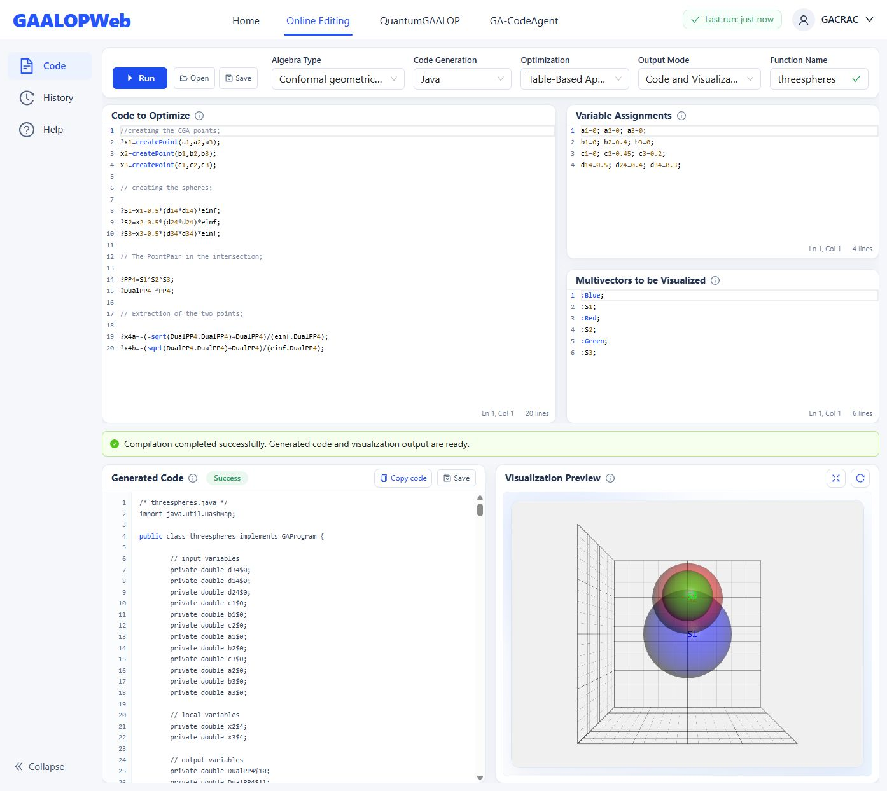

# GAALOP Forge

[English](README.md) | 简体中文

GAALOP Forge 将 [GAALOP 编译器](https://github.com/CallForSanity/Gaalop) 接入浏览器。你可以编写 GAALOPScript、生成目标语言代码，并查看几何对象或量子态概率。

项目提供两个工作台，共用 Spring Boot 后端，各自保留页面入口、启动模块和浏览器草稿。

| 工作台 | 入口 | 用途 |
| --- | --- | --- |
| GAALOPWeb | `/gaalop/` | 几何代数编译与 ganja.js 预览 |
| QuantumGAALOP | `/quantumgaalop/` | QCA、QRA 与 quantum bit geometric algebra |



## 用 Docker 启动

**1.2.0** 包含两个独立工作台、MATLAB 符号数组修复、Python 数学函数导入、QCA 五 qubit 支持，以及移除桌面插件后的 Web 运行包。

```bash
docker pull gagislab/gaalop-forge:1.2.0
docker run -d --name gaalop-forge -p 18080:8080 \
  -e GAALOP_SWAGGER_USERNAME=admin \
  -e GAALOP_SWAGGER_PASSWORD=change-me \
  gagislab/gaalop-forge:1.2.0
```

| 服务 | 地址 |
| --- | --- |
| GAALOPWeb | <http://localhost:18080/gaalop/> |
| QuantumGAALOP | <http://localhost:18080/quantumgaalop/> |
| 健康检查 | <http://localhost:18080/api/v1/health> |
| Swagger UI | <http://localhost:18080/swagger-ui.html> |

Swagger 使用 HTTP Basic 认证。通过环境变量或 Git 忽略的 `.env` 文件设置用户名和密码。镜像包含 Java 17、Nginx、Maxima 和 Linux x86_64 QRA 原生库。

从源码构建：

```bash
git clone https://github.com/GAGIS-Lab/gaalop-forge.git
cd gaalop-forge
cp .env.example .env
docker compose up -d --build
```

[Docker 发布说明](docs/docker-release.md)介绍源码构建、产物组装与运行验证。

## 使用工作台

1. 选择代数、输出语言和输出模式。
2. 在 **Code to Optimize** 中输入 GAALOPScript，或用 **Open** 打开 `.gs` 文件。打开文件后，函数名随文件名更新。
3. 在 **Variable Assignments** 中填写数值，在 **Multivectors to be Visualized** 中标记对象或状态。
4. 点击 **Run**，在下方查看生成代码和可视化结果。

**Save** 在支持原生文件访问的浏览器中写回已授权文件，其他浏览器下载副本。生成文件使用函数名和目标语言扩展名，保存位置由文件选择器确定。**Copy code** 将生成文本复制到剪贴板。

### 量子模式

| 模式 | Qubit 数 | 生成代码 | 可视化 |
| --- | --- | --- | --- |
| QCA | 1–5 | 保留自由参数的函数 | 基态概率与振幅 |
| QRA | 2–9 | 原生数值求值后的常量代码 | 基态概率与振幅 |
| quantum bit geometric algebra | 项目内置固定代数 | TBA 代码生成 | 代码生成模式 |

新工作区默认选择 QCA，已有草稿恢复原来的代数。用 `:psi;` 标记状态，变量名与脚本中的定义一致。QCA 的 **Variable Assignments** 用于可视化；QRA 在所有输出模式下都使用这些赋值进行数值计算。概率图同时显示总概率和投影残差。

量子工具栏提供 13 种输出生成器，包括 MATLAB、Python、Java、C/C++、C#、Rust、Julia 和 Mathematica。MATLAB 生成器支持数值与符号标量输入，覆盖中间数组和多个输出。Python 标量代码按需导入标准库数学函数，数组输出使用 NumPy。

容量测试采用指定脚本和单请求负载。脚本、内存和耗时见 [QCA 扩展记录](docs/qca-qubit-expansion.md)、[QRA 九 qubit 测量](docs/qra-9qubit-memory.md)及[资源脚本测试](docs/qra-resource-script-tests.md)。

### 普通页面的优化选项

GAALOPWeb 提供 TBA、CSE 和 Maxima 选项。CSE 消除重复表达式，Maxima 负责符号化简。本地安装 Maxima 后，可设置 `GAALOP_MAXIMA_COMMAND`，或在 Java 启动参数中填写 `--gaalop.maxima.command=/path/to/maxima`。

## 本地开发

使用 JDK 17、Maven 3.9+、Node.js 22 和 pnpm 10.25.0。

```bash
mvn -pl gaalop-rest -am package
java -jar gaalop-rest/target/gaalop-rest-1.0.0.jar
```

独立 Java 服务监听 `8080`，上下文路径为 `/gaalop`。健康检查地址：<http://localhost:8080/gaalop/api/v1/health>。

在 `frontend/` 中运行：

```bash
pnpm install --frozen-lockfile
pnpm dev
```

打开 <http://localhost:5173/gaalop/> 或 <http://localhost:5173/quantumgaalop/>。Vite 将 API 请求代理到后端，通过 `VITE_API_TARGET` 修改后端主机或端口。

`pnpm build` 在 `frontend/dist/` 中生成组合站点；`pnpm build:sites` 分别生成 `frontend/dist-sites/gaalop/` 和 `frontend/dist-sites/quantumgaalop/`，供独立部署使用。配置见[双站点部署](docs/two-sites-deployment.md)。

默认 Maven 构建包含 Web 服务与共享编译测试。维护旧桌面入口及发行包时使用 `-Pdesktop`。共享数学测试继续依赖 `codegen-visualizer`，REST 运行包已移除其桌面依赖，详见[构建范围](docs/desktop-web-gap-review.md)。

### REST 示例

Docker 部署向 `http://localhost:18080/api/v1/compile` 发送请求，独立 Java 服务使用 `http://localhost:8080/gaalop/api/v1/compile`。

```json
{
  "algebraPlugins": "ALGEBRA_CGA",
  "codegenPlugins": "MATLAB",
  "outputMode": "CODE_AND_VISUALIZATION",
  "optimization": { "cse": false, "maxima": false },
  "script": {
    "functionName": "sphereDemo",
    "optimizeCode": "?S=createPoint(a,b,c)-0.5*r*r*einf;",
    "variableAssignments": "a=0;b=0;c=0;r=0.5;",
    "multivectorsVisualized": ":Blue;\n:S;"
  }
}
```

响应中的 `optimizeResult` 是生成代码，`visualizationCode` 是几何预览脚本。量子结果包含振幅、概率、总概率和残差。Swagger 提供英文、中文和德文接口文档。

## 测试与维护

```bash
mvn clean test
cd frontend
node scripts/test-quantum.mjs
node scripts/test-file-access.mjs
node scripts/test-script-file.mjs
node scripts/test-workspace-import.mjs
node scripts/test-workspace-navigation.mjs
pnpm build
```

QRA 集成测试使用 `-Dgaalop.garamon.nativeDir=<原生库目录>` 指定运行库。[原生维护说明](docs/qra-acceleration-maintenance.md)介绍 Linux 构建和 C ABI。编译器使用 JUnit 4；MATLAB 和 Python 模块另有可执行的目标语言测试脚本。

systemd 健康检查访问 `/gaalop/api/v1/health`，经过启动等待后进行重试。地址或访问配置错误会写入日志；连续连接失败或服务端错误触发正常重启。安装与验证步骤见[服务器部署说明](deploy/ubuntu/README.md)。

设置 `GAALOP_COMPILE_HISTORY_ENABLED=true` 可启用编译历史。历史文件包含用户提交的脚本和生成结果。

## 项目目录

| 目录 | 内容 |
| --- | --- |
| `frontend/` | Vue 3、Ant Design Vue 与 Monaco 工作台 |
| `gaalop-rest/` | Spring Boot API |
| `api/`、`clucalc/`、`algebra/` | 编译模型、解析器和代数定义 |
| `tba/`、`gapp/`、`codegen-*/` | 优化器与输出生成器 |
| `native/qra/`、`garamon/` | QRA 原生库和 Java 桥接 |
| `testbenchTbaGapp/` | 编译回归测试 |
| `docker/`、`deploy/` | 镜像组装与服务器部署 |

更多说明：[GAALOPScript 规则](GAALOPScript_Rules.md)、[语言参考](docs/gaalopscript-analysis/02-完整语言参考.md)、[MATLAB 兼容性](docs/matlab-symbolic-codegen.md)、[Python 兼容性](docs/python-codegen-compatibility.md)、[Open/Save](docs/browser-open-save.md)、[1.2.0 更新](docs/releases/1.2.0.md)。

## 致谢与许可

Wang Jian 在南京几何代数计算与研究应用中心开展本项目，Yu Zhaoyuan、Luo Wen 和 Dietmar Hildenbrand 提供指导。

项目基于 GAALOP 扩展，采用 LGPL 3.0。组件许可见 [LICENSE](LICENSE)、[LICENSE_ganjajs](LICENSE_ganjajs)、[LICENSE_iamath](LICENSE_iamath) 和 [NOTICE.md](NOTICE.md)。
