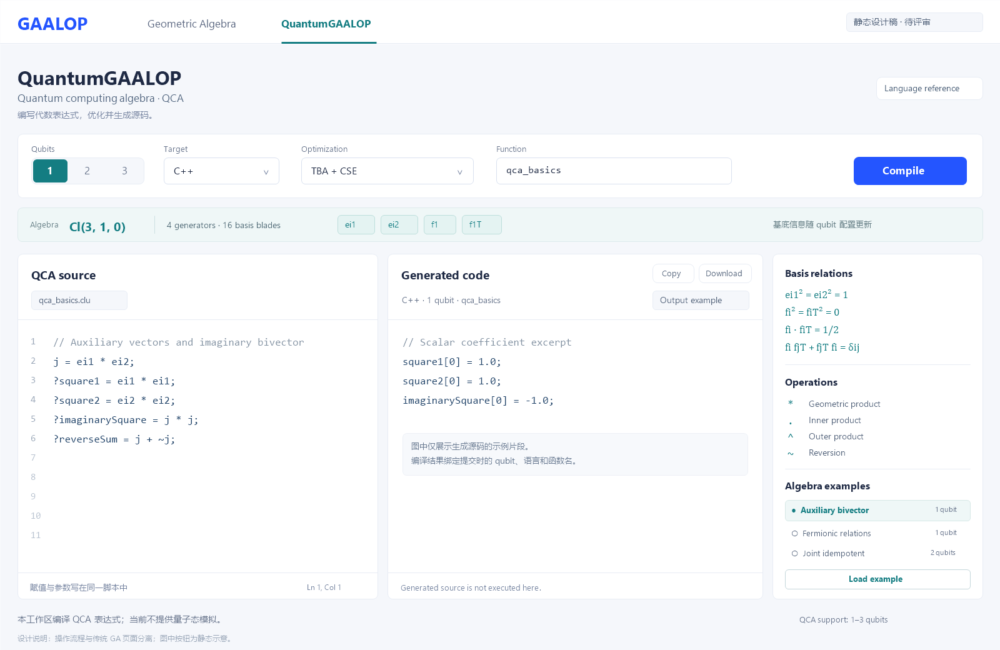

# QuantumGAALOP 前端设计稿 v1

状态：仅供评审，未实施。2026-09-14。独立量子页面尚未接入现有前端；本轮开始的接入改动已撤回。

2026-09-15 更新：按用户要求，传统网页的 QCA 和旧 QGA 入口均已移除，相关共享核心/API 保留。下文关于 Legacy QGA 入口的描述仅为当时的设计讨论，不代表当前网页仍保留该入口。

## 定位与命名

为使用量子计算代数编写表达式的研究者提供独立网页，完成“配置代数 → 编写表达式 → 优化编译 → 查看、导出源码”。

页面入口采用 **QuantumGAALOP**，代数名称保留上游 **Quantum computing algebra（QCA）**。传统工作区保留几何代数选择与几何可视化流程。两个入口共享应用导航和后端编译核心，分别组织页面、编辑内容、参数与结果。

本页定位是 QCA 表达式编译工作台。当前服务返回生成源码，没有量子态求值、测量概率、量子电路执行或 Bloch 球数据接口，因此设计中不设置这些操作和展示区域。



图中为设计示意，输出区域使用示例系数片段；不是运行中的页面截图，也不是完整可执行 C++ 文件。控件与状态的准确约定以本文为准。

## 页面布局

```text
GAALOP       Geometric Algebra       QuantumGAALOP（当前）
──────────────────────────────────────────────────────────────
QuantumGAALOP
Quantum computing algebra · QCA                 Language reference

Qubits [1 / 2 / 3]  Target [C++]  Optimization [TBA + CSE]
Function [qca_basics]                              [Compile]

Cl(3, 1, 0)   4 generators · 16 basis blades   ei1 ei2 f1 f1T
──────────────────────────────────────────────────────────────
QCA source                   Generated code         Reference
qca_basics.clu               C++ · 1 qubit           基底关系
                            qca_basics             运算符
源码编辑器                   生成源码                代数示例
                            [Copy] [Download]      [Load example]
──────────────────────────────────────────────────────────────
编译状态 / 错误信息 / 结果是否对应当前草稿
```

桌面以源码和生成源码为主体，两栏各约 40%，参考栏约 20%。中等宽度将参考栏移到下方；窄屏使用“Source / Output / Reference”标签切换，参数自动换行。生成代码保持等宽字体与横向滚动，避免强制断行改变代码阅读。

保留现有蓝白工作台的视觉体系：背景 `#F5F7FB`、面板 `#FFFFFF`、正文 `#1F2A44`、主操作 `#2455FF`、量子页强调 `#147D82`、分隔线 `#E7ECF4`。标题和正文使用 Segoe UI / 中文系统字体；代码用 Cascadia Mono / Consolas。通过基底条体现量子页身份，不使用没有数据来源的电路或球形装饰。

## 控件与现有能力的对应

| 区域 | 拟设计内容 | 现有能力依据与限制 |
| --- | --- | --- |
| Qubits | 1、2、3 分段选择，禁止小数 | Web 当前限制为 1–3；核心 1–10 的生成范围不等于 Web 已完成相应规模验证 |
| 代数信息 | 显示签名、向量数、基底 blade 数和名称 | 来源为 QCA 动态定义，按当前配置计算 |
| Target | 首版优先 Python、C++ | 已有实际编译响应及源码检查；不表示所有生成程序均经过各语言运行验证 |
| Optimization | TBA、TBA + CSE | 两条编译路径均已测试；Maxima 依赖服务端外部环境，暂不设为首版普通选项 |
| Function | 输出函数名称 | 对应现有 `script.functionName` |
| QCA source | 一个源码编辑区 | 数值赋值与表达式写在同一脚本；代码模式下，现有独立 Variable Assignments 字段不会被合入脚本 |
| Compile | 提交并生成源码 | 调用现有编译接口，不执行生成的代码 |
| Generated code | 源码、提交参数、复制和下载 | 当前接口主要返回拼接文本；保留生成源码原貌，不伪造数值执行结果 |
| Reference | 基底关系、已验证运算符与三个代数示例 | 以下示例已通过实际编译与 CFG 数值解释 |

Java 核心代码生成已验证，但当前 REST 将多个输出文件合成字符串。应先确定多文件展示/下载设计，再纳入首版页面，避免把多个 Java 文件保存为一个无法直接编译的文件。其余目标逐项验证后再开放，不从现有通用下拉框直接全部复制。

| qubit 数 | 签名 | 生成向量数 | blade 总数 | 基底名称 |
| --- | --- | --- | --- | --- |
| 1 | Cl(3,1,0) | 4 | 16 | ei1, ei2, f1, f1T |
| 2 | Cl(4,2,0) | 6 | 64 | 增加 f2, f2T |
| 3 | Cl(5,3,0) | 8 | 256 | 增加 f3, f3T |

基底条需说明：`ei1`、`ei2` 是辅助向量，`fi`、`fiT` 是 QCA 基底名称；blade 总数不是量子态的振幅数量。`fiT` 为完整标识符，不能在编辑器中拆成转置语法。

参考栏列出：`ei1²=ei2²=1`，`fi²=fiT²=0`，`fi·fiT=1/2`，`fi fjT + fjT fi = δij`；运算符为几何积 `*`、内积 `.`、外积 `^`、反序 `~`。

## 交互约定

- **进入页面**：首次显示辅助二重向量示例和 1 qubit。传统 GA 的 CGA 示例、颜色脚本与几何预览不带入量子页。
- **切换工作区**：保留各自的草稿、参数、光标、撤销记录和结果。这里指当前会话内保留；尚未设计保存机制时，不显示“All changes saved”。
- **调整 qubit**：更新基底条，不重写用户脚本。若出现超出当前范围的 `fi` 类名称，应提示检查配置，不能静默删除或改名。现有编译器会把未定义名称视为标量，此处需要诊断设计，不能宣称当前后端已拒绝这类输入。
- **加载示例**：先选择并查看说明，再点 Load example；说明将替换当前脚本并设置所需 qubit，保留取消替换的机会。示例预期值是说明，不伪装为当前计算结果。
- **编译期间编辑**：允许继续改稿。返回结果标注提交时的 qubit、语言、函数名，并在有新修改时提示“结果对应先前提交，当前草稿尚未编译”。
- **切页时请求返回**：结果回到发起请求的工作区，不覆盖另一页，也不将另一页标成成功。
- **导出结果**：使用该次提交的名称与语言；之后修改下拉框不能改变旧结果的扩展名。Copy / Download 在无结果时不可用。
- **查看语言参考**：打开当前 QCA 运算说明。暂不推荐 `createPoint` 或一元 `Dual`：上游这两个宏目前只是恒等实现。

| 状态 | 用户看到的内容 |
| --- | --- |
| 未编译 | “编写 QCA 表达式，点击 Compile 生成源码。” |
| 编译中 | 按钮显示 Compiling；保留可编辑源码；旧输出如保留应明确标注 |
| 成功 | “源码已生成”，展示该次提交参数；不显示“量子模拟完成” |
| 失败 | 展示接口返回的具体错误，保留草稿；如展示上次成功输出，明确这是旧结果 |
| 编译后修改 | “结果对应先前提交”；不将旧输出标为当前结果 |

不设计虚假的精确进度百分比；现有接口未提供进度事件。错误行号仅在后端返回可定位信息时展示。

## 三个可用的代数示例

以下是本项目依据 QCA 定义构造的示例，不是上游提供的量子算法库。

### 辅助二重向量（1 qubit，默认）

```clu
j = ei1 * ei2;
?square1 = ei1 * ei1;
?square2 = ei2 * ei2;
?imaginarySquare = j * j;
?reverseSum = j + ~j;
```

预期：前三个标量为 1、1、−1，`reverseSum=0`。零分量可能被优化后省略输出赋值，不能据此报告编译失败。

### 费米关系（1 qubit）

```clu
?half = f1 . f1T;
?anti = f1 * f1T + f1T * f1;
?nil = f1 * f1;
?wedge = f1 ^ f1T;
```

预期：`half=0.5`、`anti=1`、`nil=0`；`wedge` 为对应二阶基底。

### 联合幂等元（2 qubits）

```clu
p1 = f1 * f1T;
p2 = f2 * f2T;
p = p1 * p2;
?cross = f1 * f2T + f2T * f1;
?commutator = p1 * p2 - p2 * p1;
?idempotence = p * p - p;
?projector = p;
```

预期：前三个输出为零；`projector` 的标量系数为 1/4、两个相关二阶系数为 1/2、对应四阶系数为 1。页面称其为代数幂等元示例，不赋予未经实现验证的测量流程。

## QGA 与 QCA 的处理

上游 QGA 的显示名称确为 `quantum bit geometric algebra`，但其资源是固定的 Cl(6,3,0)、9 向量和 512 blade，宏库包含点、球、椭球等构造；它不使用 QCA 的可变 `fi/fiT` 基底。上游当前将其标为 deprecated。

本设计的 QuantumGAALOP 主工作区只针对 QCA。旧 QGA 保留兼容入口并注明 Legacy；若将来也归入量子导航，应单独组织模式、说明与示例，不套用 QCA 的 qubit 控件。本轮不更改它的名称或归类。

## 开始实现前需要处理的已知问题

实测发现：VERILOG、GAPP_DEBUGGER 在无图形环境返回 500；GAPP_OPENCL 可能返回成功但生成无效源码；GAALET_OUTPUT 对 QCA 的高阶分量越界。这些目标不进入本页首版选项。QCA 后端目前仍允许其中部分请求，未来实现时需要同步能力校验。

原始 JSON 的 `algebraDimension:1.5`、`3.9` 会被截断为整数，需要独立修复 API 校验。此轮只记录问题，未提交相关功能修复。

## 证据与验证

- 上游参考版本：orat/Gaalop `b09ce5b91312611bc8262be26cfe50d804499700`，包含度量修复 `11da0993d2278945a83a98717c4dd5b8325015c0`。
- 动态定义：[AlgebraDefinitionFile.java](../api/src/main/java/de/gaalop/cfg/AlgebraDefinitionFile.java)，`createQCA` 与 `getSignatureString`。
- 宏的实际内容：[QCA macros.clu](../algebra/src/main/resources/de/gaalop/algebra/algebra/qca/macros.clu)。
- 服务边界：[GaalopCompileService.java](../gaalop-rest/src/main/java/de/gaalop/rest/service/GaalopCompileService.java)，`validateQcaRequest`、`buildScript`、`selectGeneratedText`。
- 独立矩阵验证：[QcaMatrixOracleTest.java](../tba/src/test/java/de/gaalop/tba/QcaMatrixOracleTest.java)，1–3 qubit 全部 69,888 个有序 blade 几何积及 18 组混合多向量。
- 页面示例验证：[QcaWebExamplesTest.java](../testbenchTbaGapp/src/test/java/de/gaalop/testbenchTbaGapp/tba/QcaWebExamplesTest.java)，三个示例共 16 次编译与数值解释，覆盖有效 qubit 范围和 CSE 开/关。
- 本轮最终 `mvn clean test`：222 项测试，0 失败、0 错误、0 跳过。现有前端 `pnpm build` 通过。测试通过不代表上述旧输出插件问题已修复。

图片生成服务因网络错误未能返回图像，最终设计稿采用可编辑 SVG 静态排版，并导出 PNG。矢量原稿为 [qca-workspace-v1.svg](design/qca-workspace-v1.svg)。本轮交付是静态视觉设计和交互约定，不包含独立量子页面的生产实现。
