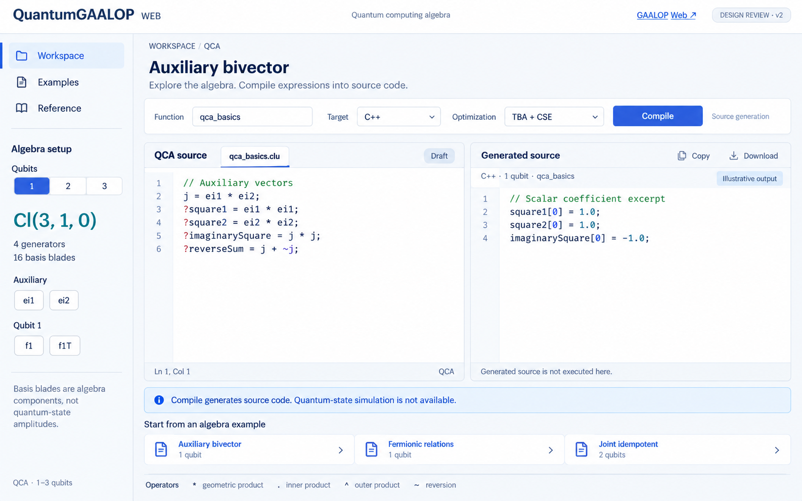

# QuantumGaalopWeb 网页设计 v2

2026-09-15 · 设计评审稿 · 未实施

本轮仅交付图片与设计说明，没有修改传统 GaalopWeb、编译核心或 API。v1 保留作为历史方案，本稿采用独立网站结构。

图中代码为示意片段，标记为 Illustrative output；不是运行截图或完整生成文件。

## 定位

面向使用量子计算代数进行表达式推导与代码生成的研究者。站点品牌为 QuantumGAALOP Web，代数名称沿用上游 Quantum computing algebra（QCA）。主要流程是：配置 qubit → 编辑 QCA 表达式 → 编译优化 → 查看与导出源码。

现有核心已验证动态 QCA、几何积、内积、外积、反序与 TBA/CSE 编译。当前 REST 没有量子态求值、测量概率或电路执行接口，所以本稿不设置量子门面板、电路编辑器、概率图或 Bloch 球。`createPoint` 和 `Dual` 仍是上游恒等占位宏，不作为完整功能推荐。

## 页面组织

| 位置 | 内容与用途 |
| --- | --- |
| 顶栏 | 独立站点名称；右侧 GAALOP Web 链接通往传统站点，不切换当前表单的代数模式 |
| 左侧导航 | Workspace、Examples、Reference，分别处理编辑、示例选择与语言查阅 |
| 左侧代数配置 | qubit 1–3、当前签名、生成向量数、blade 数；辅助向量与各 qubit 基底分组展示 |
| 主区标题 | 当前示例或文档名称，如 Auxiliary bivector；不用营销式大幅封面 |
| 编译工具栏 | 函数名、目标语言、优化方式、Compile；按钮语义是生成源码 |
| 主区左栏 | 一个 QCA 源码编辑器；常量、参数赋值和表达式写在同一脚本中 |
| 主区右栏 | 生成源码、此次提交的参数、复制与下载；不把生成代码当成模拟结果 |
| 底部 | 编译状态、三个代数示例快捷入口、运算符速查 |

左侧约 240px，主区剩余宽度由两个编辑面板均分。相比 v1，将配置与基底参考合并到侧栏，使源码区域更宽，并为 Examples、Reference 留出独立页面组织方式。

## 配置与信息准确性

- Qubit 使用 1 / 2 / 3 离散选择，避免输入小数。后台的小数截断问题仍需未来单独修复，不能只靠前端控件保证合法性。
- n=1、2、3 时分别显示 Cl(3,1,0)、Cl(4,2,0)、Cl(5,3,0)；向量数为 4、6、8；blade 数为 16、64、256。
- 基底标签保留源码拼写：`ei1`、`ei2`、`f1`、`f1T` 等。`f1T` 是完整标识符。blade 数不等于量子态振幅数量。
- 首版目标语言建议 C++、Python。Java 能生成代码，但需先补齐现有多文件响应的展示与导出约定，再加入完整下载流程。
- 优化选择 TBA 与 TBA + CSE。其他目标或依赖外部环境的优化项，经过对应验证后再开放。
- 旧 QGA 与动态 QCA 不混合；QGA 的固定基底和几何宏不套用此页的 qubit 控件。

## 三个页面的交互

### Workspace

初次进入加载辅助二重向量示例，配置为 1 qubit。修改 qubit 仅更新基底参考，不改写用户源码；检测到超出当前范围的基底式名称时提醒检查配置，不直接改名或删除。

编译时捕获本次提交的脚本与参数。编译过程中仍可编辑；新结果显示提交时的语言、qubit 数和函数名。若草稿已有改动，提示“当前草稿尚未编译，显示的是先前提交的结果”。下载文件名和扩展名始终根据生成该结果时的参数确定。

初始无输出时禁用 Copy、Download。失败时保留草稿并展示具体错误；若保留上次输出，应明确标注。没有实时进度接口，不显示虚构百分比。没有持久保存能力时，不显示“All changes saved”。

### Examples

只展示已核实的三个代数示例：辅助二重向量、费米关系、联合幂等元。每项包含所需 qubit、源码预览、用途与预期数学关系；预期关系不能标成当前执行结果。

点击示例先预览，再通过“Load into workspace”载入。已有修改时说明将替换脚本，并允许取消；载入时同步设置示例所需 qubit。它们是本项目从 QCA 定义构造并测试的代数示例，不标为上游量子算法库。

### Reference

围绕当前 QCA 提供：基底名称与关系、`*` / `.` / `^` / `~` 运算、输出标记 `?`、参数赋值、代码生成说明。优先使用与当前 qubit 配置一致的基底。移除传统 CGA 的颜色指令、几何体预览和 `createPoint(x,y,z)` 提示。

## 状态文案

| 状态 | 拟用文案 |
| --- | --- |
| 未编译 | Edit QCA expressions, then compile to generate source. |
| 编译中 | Compiling… |
| 成功 | Source generated. |
| 失败 | 显示后端具体错误；仅在有可信定位信息时标出错误行 |
| 已修改 | Draft changed. Output belongs to an earlier submission. |

视觉稿中的 DESIGN REVIEW、Draft、Illustrative output 用于描述本稿状态；正式页面应根据真实状态显示，不固定保留评审标签。

## 视觉与响应式约定

背景 `#F4F7FB`、面板 `#FFFFFF`、正文 `#20314C`、次要文字 `#73839A`、主操作 `#2859DA`、基底强调 `#177F82`、边框 `#DDE5EF`。标题和正文使用 Segoe UI / 中文系统字体，源码使用 Cascadia Mono / Consolas；8px 圆角与轻微阴影。

宽屏保留并排源码。中等屏幕可折叠左侧配置；窄屏将 Source 与 Generated source 改为标签页，配置使用可展开区域。代码保留横向滚动。所有输入有明确标签和键盘焦点，不能只靠颜色区分成功、失败或旧结果。

## 交付与边界

- [主工作台视觉稿 PNG](design/qca-workspace-v2.png)
- [生成提示词](design/qca-workspace-v2-prompt.txt)
- 图片使用内置 imagegen 生成，已核对关键基底名称、1 qubit 签名与示例系数。
- 现阶段完成主工作台视觉设计及 Examples / Reference 交互规划；后两页未另出高保真图片。
- 本稿不是功能实现，也不意味着旧生成器兼容问题、API 校验问题或文件导出问题已修复。
