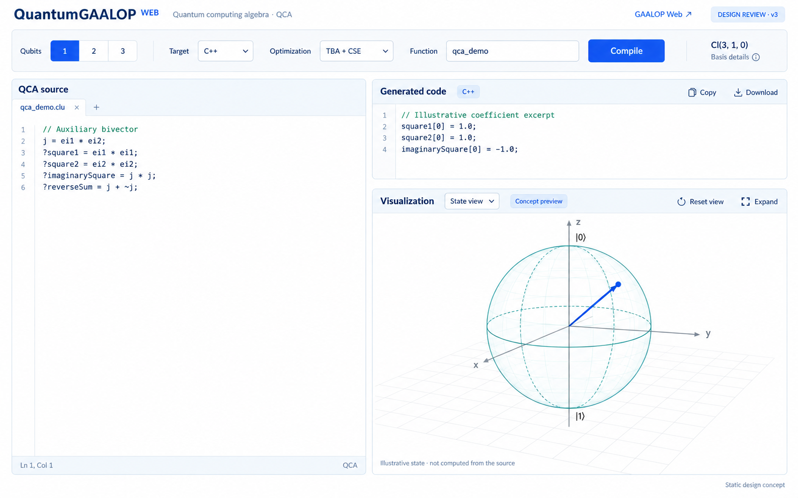

# QuantumGaalopWeb 设计 v3

状态：静态设计评审，未进行功能代码实现。此稿根据用户反馈替代 v2 的主页面布局。

## 本轮调整

移除用户截图中的全部常驻内容：

- Workspace / Examples / Reference 左侧导航。
- 底部“当前不支持量子态模拟”的整行提示条。
- 三张示例推荐卡片及其标题。
- 底部运算符速查。

这些内容不必占据工作台空间。未来如需要示例和参考，采用按需打开的入口，具体位置另行确定；不在本稿中重新增加导航面板。

## 主页面结构

顶部为独立 QuantumGAALOP Web 品牌和返回传统 GAALOP Web 的链接。下方一行集中配置 qubit、目标语言、优化方式、函数名和 Compile；签名与基底详情收纳为紧凑信息。

主体分为三个同时可见的区域：

| 区域 | 比例与作用 |
| --- | --- |
| 左侧 QCA source | 约 45% 宽度，占主体全高，专注脚本编辑 |
| 右上 Generated code | 约 55% 宽度、右栏约三分之一高度，查看与导出源码 |
| 右下 Visualization | 右栏约三分之二高度，作为主要结果呈现空间，保留重置视角和放大操作 |

后续布局可以支持拖动分隔线调整区域大小。窄屏按源码、生成代码、可视化顺序排列，或通过标签切换；可视化仍保留独立放大查看的入口。

## 可视化的设计边界

用户已明确要求保留可视化，因此它是本设计的一等区域。图中的 Bloch 球仅用于说明视口比例、坐标和交互控件，不代表已经决定只支持此类图，也不是左侧示例的计算结果。

已在图中标记 Concept preview 和 Illustrative state。现有左侧示例计算辅助向量及二重向量的平方，没有定义图中量子态。正式产品不可将二者直接关联。

State view 是拟议视图入口。最终支持 Bloch 球、电路图、概率图或代数关系图，需要分别确定用户需求和数据来源。现有 REST 没有提供量子态求值或测量概率接口；保留视口不等于这些能力已经实现。

实现时应区分：尚无数据、图形加载中、可展示结果、数据不支持、结果对应旧脚本。无数据时不显示默认的假量子态。若采用 Bloch 球，多 qubit 的整体态不能直接当成单个球上的向量，应先明确单 qubit 约化态等表示方式。

编译与可视化的数据关联、触发方式、视图种类在实现前需进一步确认。本轮不增加量子计算接口。

## 控件与细节

- qubit 首版维持已核实的 Web 范围 1–3。
- 目标语言与优化选项遵循 v2 的能力边界；页面不再常驻大量说明。
- Copy / Download 面向真实生成结果；结果绑定提交时的脚本与参数。
- 图中的文件标签、关闭与加号是视觉表现，不表示本轮已确定多文档管理需求；首版可保持单文档编辑。
- DESIGN REVIEW、Concept preview 等为评审状态标识，正式页面根据实际状态显示。

## 交付

- [PNG 视觉稿](design/qca-workspace-v3.png)
- [内置 imagegen 的生成提示词](design/qca-workspace-v3-prompt.txt)

本轮只新增设计资料，没有修改传统 GaalopWeb、后端或量子前端功能代码。
