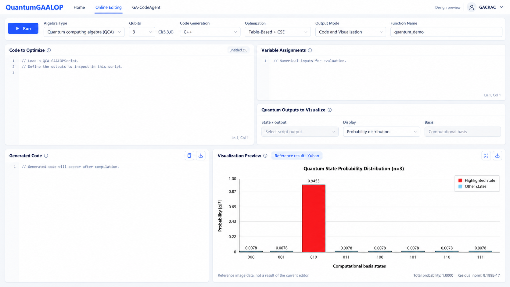

# QuantumGaalopWeb 设计 v4：沿用现有 GAALOP 页面结构

仅为设计评审稿，未修改前后端功能代码。本稿以用户最新提供的 GaalopWeb 截图为布局依据，替代 v3 的布局；传统站点仍保持独立。

## 保留与删除

保留原页面的顶部导航、横向运行工具栏、上部三个输入区和下部两个结果区。移除左侧 Code、History、Help、Collapse 整栏，让工作区域占满页面。延续蓝白配色和现有组件样式。

按照此前反馈，不恢复示例推荐卡片、运算符速查和大幅提示条。普通运行状态放在顶部或运行按钮附近；错误信息按需出现，不占固定大面积。

## 量子内容如何调整

| 原控件或区域 | 量子页面设计 |
| --- | --- |
| Algebra Type | 固定显示 Quantum computing algebra（QCA），无需重复选择 CGA 等传统代数。图中的下拉外观仅为风格示意，首版可设只读 |
| 新增 Qubits | 1、2、3 的离散选择，随配置显示 Cl(n+2,n,0)；图中 n=3 对应 Cl(5,3,0) |
| Code Generation | 保留目标语言选择，首版优先已经检查过的 C++、Python；其他目标逐项验证后开放 |
| Optimization | 保留 TBA、TBA + CSE；不默认启用依赖外部环境的 Maxima |
| Output Mode | 保留代码、可视化、代码与可视化的概念；量子可视化模式须在 Yuhao 后端接入后才能成为真实可用选项 |
| Code to Optimize | 保留 GAALOPScript 编辑器；使用 QCA 基底与实际算法脚本，不改为量子门拖拽编辑器 |
| Variable Assignments | 保留，作为数值求值所需的输入值区域，与符号算法脚本分离；参数如何进入求值流程需对接实际接口 |
| Multivectors to be Visualized | 调整为 Quantum Outputs to Visualize，选择可展示的脚本输出及图形形式，移除 CGA 的颜色与几何对象命令 |
| Generated Code | 保留生成源码、复制和下载 |
| Visualization Preview | 采用用户提供的计算基态概率分布形式，保留放大与图像导出 |

上部源码区域与右侧参数/输出配置区域保持原有左右分区。右侧输出选择表单无需保留与代码编辑器相同的高度。下部可视化约占 60% 宽度，生成代码约占 40%，使 8 个状态标签更易读。

## Quantum Outputs to Visualize

1. **State / output**：从实际脚本输出及量子后端可识别结果中选择，不手写未经确认的 `psi`、`probabilities` 宏或新指令。
2. **Display**：首版明确采用 Probability distribution，不先增加未经核实的 Bloch 球或电路图。
3. **Basis**：Computational basis，首版作为说明性只读信息；具体比特顺序遵循数据接口定义。

未载入脚本或没有可识别输出时，选择器为空且不可生成结果。纯代码模式下参数求值和结果选择区可以收起或禁用；修改图形显示设置不应无条件重新编译算法。

这些是拟议交互，不是当前 API 已有的字段契约。当前代码模式不会合并独立 Variable Assignments，QCA 可视化请求也仍被拒绝；后续实现需要接入实际求值及可视化路径，而非只启用控件。

## 概率图与参考数据

设计图采用用户提供的 Yuhao 结果作为参考：3 qubit，基态从 000 到 111；010 的概率标为 0.9453，其他七项标为 0.0078；总概率 1.0000，残差范数 8.189E-17。

源图的概率标签经过舍入，不能用标签求和反推完整精度。正式图应使用后端原始数据、严格线性坐标和动态标签，不直接使用此设计图片。总概率和残差均来自实际计算数据，不能固定显示或自行定义残差含义。

红色用于突出被指定的状态；只有算法及结果元数据明确时才标为 Solution，低概率状态不自动等同于噪声。悬停显示完整基态和概率；放大保持同一结果，导出包含必要的参数与坐标标签。

图中源码及参数为空占位，未提供或编造 Grover 实现。概率图明确标为 Reference result · Yuhao，不能误认为由当前编辑器内容运行得来。正式空白工作区应显示空结果；载入真实例程并求值后再显示计算图。

## 后续对接需明确的事实

- Yuhao 的实现作为何种 GAALOP 后端/插件运行，如何从脚本与给定参数产生数值结果。
- 输出是完整图像、可执行展示内容、振幅数据还是概率数据，及相应格式。
- 输出对象名称、基态顺序、实部/虚部表示、归一化与残差定义。
- 一次执行是否能产生多个结果或中间状态；哪些错误可定位到源码。

邮件确立了共享后端、独立前端及接入已有量子可视化的方向，但不能据此假定上述协议已经确定。本轮只设计控件职责，不实现计算和数据接口。

## 交付

主图：[qca-workspace-v4.png](design/qca-workspace-v4.png)。使用内置 imagegen，以用户的 GaalopWeb 截图为布局参考、概率分布截图为结果参考；[提示词](design/qca-workspace-v4-prompt.txt)随稿保存。
