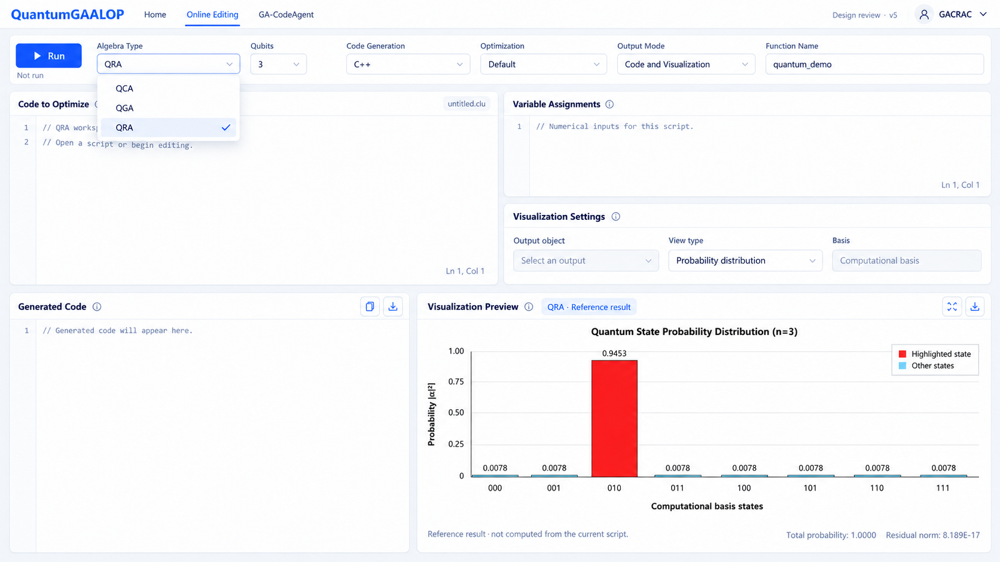

# QuantumGaalopWeb 前端设计 v5

> 本版可视化输入区的下拉框设计已作废。以 [v6](quantum-gaalop-web-design-v6.md) 为准：恢复 Multivectors to be Visualized 的 GAALOPScript 编辑器。

2026-09-16 · 静态评审稿 · 仅设计，不实施

本版明确将 QCA、QGA、QRA 全部纳入独立 QuantumGaalopWeb 的前端设计范围。先确定界面与交互，再讨论集成。未修改传统 GaalopWeb、后端或任何功能代码。

## 统一页面

沿用用户指定的 GaalopWeb 布局：顶部导航和配置栏，上方为源码、变量赋值与可视化设置，下方为生成代码与可视化结果。删除 Code、History、Help、Collapse 侧栏，不恢复示例卡片及运算符速查。

顶部 Algebra Type 提供 QCA、QGA、QRA 三个平等入口。它们是不同的代数/实现模式，不是 Grover、Shor 等算法选择。

本张图展开下拉框以展示三个入口，并以 QRA 概率图说明结果区的空间。图中是参考结果，不表示已完成集成或执行了当前脚本。

## 三种模式的界面差异

| 项目 | QCA | QGA | QRA |
| --- | --- | --- | --- |
| 名称 | QCA；说明中显示 Quantum computing algebra | QGA；说明中保留上游 Quantum bit geometric algebra | QRA；不擅自扩写名称 |
| 代数配置 | 显示 Qubits；当前已核实 Web 范围为 1–3 | 不显示可变 qubit 输入；显示 Fixed algebra，并可查阅基底说明 | 显示该模式自己的 qubit/版本配置；设计图以 3 qubit 作示意，不直接复制 QCA 范围 |
| 源码区 | QCA 独立草稿与语法提示 | QGA 独立草稿与语法提示 | QRA 独立草稿与语法提示 |
| 变量赋值 | 对应当前脚本的数值输入 | 对应当前脚本的数值输入 | 对应当前脚本的数值输入 |
| 生成语言、优化方式 | 显示适用于 QCA 的选项 | 显示适用于 QGA 的选项 | 显示适用于 QRA 的选项 |
| 可视化设置 | 保留区域，按实际可解释结果提供视图 | 保留区域，不默认将其结果解释为量子概率 | 以已见的计算基态概率分布作为主要设计参考 |
| 结果 | 标记 QCA 与本次提交配置 | 标记 QGA 与本次提交配置 | 标记 QRA 与本次提交配置 |

QGA 的 Fixed algebra 是界面配置说明，不是删除或降级该模式。三种模式都在本次产品范围内，但不承诺它们有完全相同的参数和可视化种类。最终取值范围和选项清单在后续集成评估时确定。

## 工作区的五个区域

1. **Code to Optimize**：保留 GAALOPScript 编辑，提示内容随代数模式变化，不把 QCA 的 fi 标识符套给 QGA。
2. **Variable Assignments**：保留参数输入；仅展示当前模式脚本的内容，切换模式不串用参数。
3. **Visualization Settings**：使用中性的区域名，包含 Output object、View type 及必要的基底说明。没有有效输出时不预填虚构对象；不把固定变量名 res 暴露成所有模式必须遵守的新规则。
4. **Generated Code**：保留代码展示、复制、下载。结果附带生成时的模式、语言与函数名称。
5. **Visualization Preview**：三种模式都保留此区域。实际图形由所选输出及可用视图决定；QRA 设计图采用概率柱状图，不将同一图无条件用于 QCA/QGA。

概率图设计保留基态标签、概率轴、数值悬停、放大与导出。总概率和残差仅在结果提供相应值时显示。没有结果时显示空状态，不放置假的默认量子态。

## 模式切换

- 初次进入可以默认 QCA；本图选中 QRA 仅为展示已有概率图参考，不规定产品默认值。
- 每种模式保留当前会话内各自的源码、输入参数、编译设置和最近结果。切换到新模式首次显示空草稿或该模式已验证的初始内容。
- 切换不自动翻译脚本、不重解释已有多向量、不自动运行。用户若希望迁移一份脚本，应主动复制并适配。
- 正在运行时切换模式，结果仍归属于发起运行的模式，不能覆盖当前页面。
- 修改参数后，旧输出标为先前提交的结果。下载使用原提交配置，不受后来切换模式或语言影响。
- 模式切换后的配置栏保持高度稳定；QGA 用紧凑的固定代数说明占据相应位置，避免整体工具栏大幅跳动。

## 输出模式与状态

保留 Code Only、Visualization Only、Code and Visualization 的交互概念。某模式尚未具备某项能力时，应就近解释选项状态；不产生假成功，也不永久移除可视化区域。未接入时的不可用状态与运行失败应区别显示。

Run 保持统一操作入口，附近使用 Not run / Running / Completed / Failed 等简短状态。错误在对应区域按需展示，不恢复常驻大幅说明条。不显示尚无保存机制支持的 All changes saved。

宽屏保持五区布局，下部可视化约 60%、代码约 40%；窄屏依次显示配置、输入、结果，可视化支持放大。所有可编辑项有明确标签，状态不只依赖颜色。

## 本轮交付

- [主界面视觉稿](design/quantum-workspace-v5.png)
- 本文的三模式配置差异与交互约定
- [内置 imagegen 的生成提示词](design/quantum-workspace-v5-prompt.txt)

使用 v4 设计图作为编辑目标生成 v5。代码栏为空占位，概率图沿用用户提供的参考数据。此次不确定后端接口格式、不移植计算模块、不进行功能代码实现；后续按用户要求，在前端设计确认后再评估集成。
