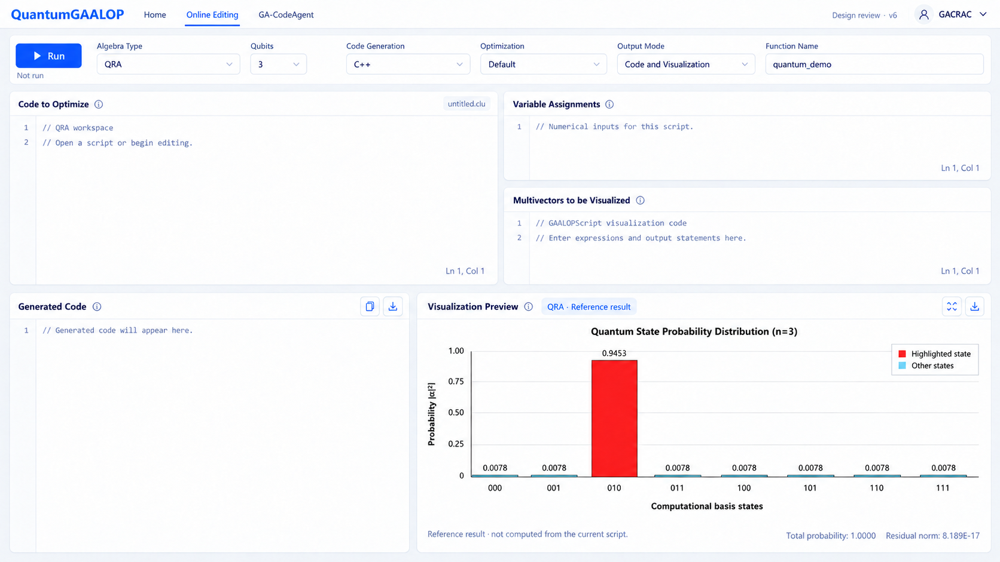

# QuantumGaalopWeb 前端设计 v6

> 已纳入 [固定设计基线](quantum-gaalop-web-design-baseline.md)。后续实现和代码合并以该基线为准。

2026-09-16 · 静态评审稿 · 仅设计，不实施

本版修正 v5 对原生 GaalopWeb 可视化输入方式的误解：可视化区域仍是 GAALOPScript 编辑器，不是输出对象或视图类型的选择表单。v5 中相关下拉框设计作废。

## 页面布局

沿用原生 GaalopWeb 的五个区域，移除 Code、History、Help、Collapse 侧栏。

| 区域 | 设计 |
| --- | --- |
| Code to Optimize | 左上主要 GAALOPScript 编辑器，保留行号与语法高亮。 |
| Variable Assignments | 右上脚本编辑器，输入变量赋值语句。 |
| Multivectors to be Visualized | 右侧第二个脚本编辑器，输入原生可视化脚本；保留行号、语法高亮和编辑状态。 |
| Generated Code | 左下展示生成代码，保留复制与下载。 |
| Visualization Preview | 右下展示计算结果图，保留放大操作。 |

删除可视化输入区的 Output object、View type、Basis 下拉框。该区不改成变量多选器，也不以表单代替脚本。三个输入编辑器共同构成脚本工作流程。

顶部 Algebra Type 保留 QCA、QGA、QRA 三个入口。切换后保留各模式独立草稿；参数范围、生成语言和优化选项应依据各自实现确定。QGA 不强加可变 qubit 配置。v6 图片中 QRA 与 3 qubit 仅为布局示意。

## 与现有工程的对应

现有 frontend/src/App.vue 中，Multivectors to be Visualized 使用 form.script.multivectorsVisualized 文本编辑。gaalop-rest/src/main/java/de/gaalop/rest/service/GaalopCompileService.java 的 buildScript 方法在可视化模式下按变量赋值、优化源码、可视化脚本的顺序拼接输入。这支持保留原生脚本输入方式，而不是把该区域限制为对象选择。

这是前端设计依据，不表示三种量子模式已经接入可视化。各模式脚本如何被解析并转换为图表数据，留待后续集成核对；此处不创造通用量子可视化语法，也不要求全部模式使用固定输出变量名。

## 图表与状态

概率柱状图采用用户提供的 3 qubit 参考图：010 标注 0.9453，其余状态标注 0.0078，总概率与残差作为附属结果信息。图中是参考数据，不是占位源码执行结果；概率较小本身不等于噪声，概率最大本身不等于算法解。

源码区使用注释占位，待确认真实 GAALOPScript 示例后再替换。保留简洁运行状态，不恢复大段教学提示、示例卡片或操作符速查。

本次仅更新设计图片与说明，未修改传统 GaalopWeb、QuantumGaalopWeb 功能代码或后端。

生成提示词：design/quantum-workspace-v6-prompt.txt。
